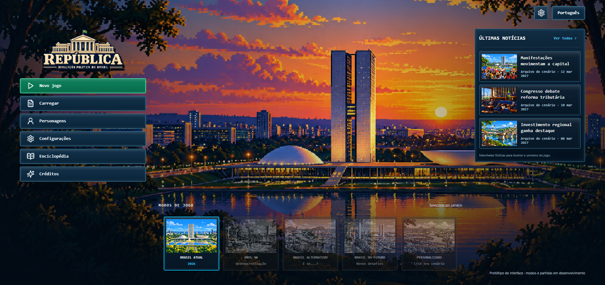
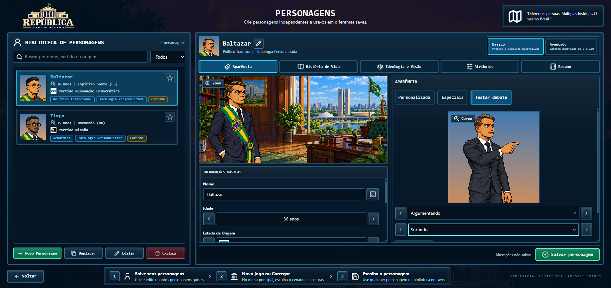
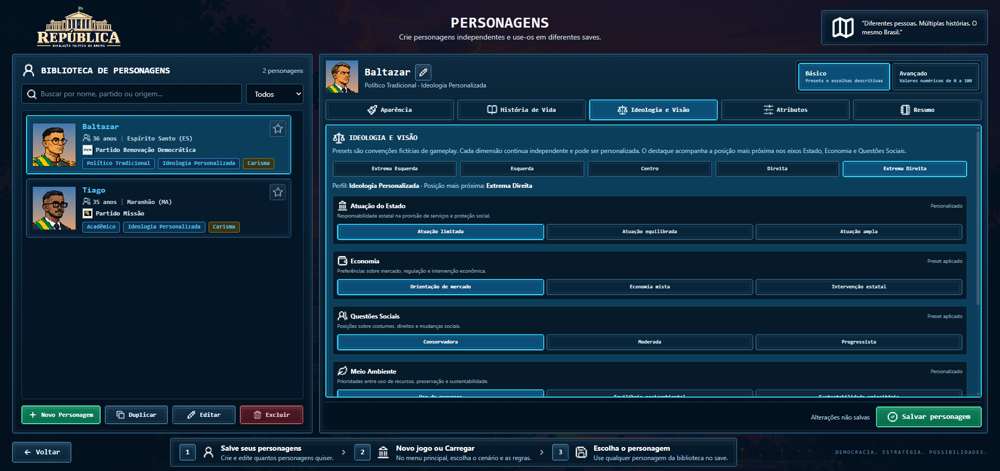
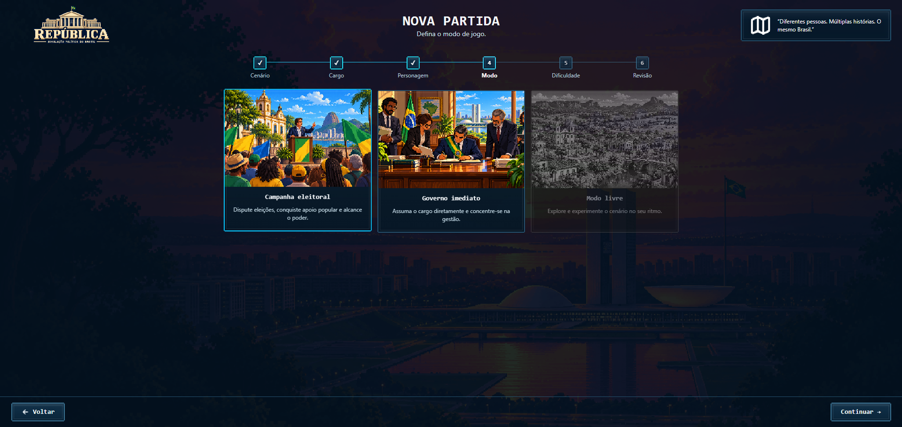
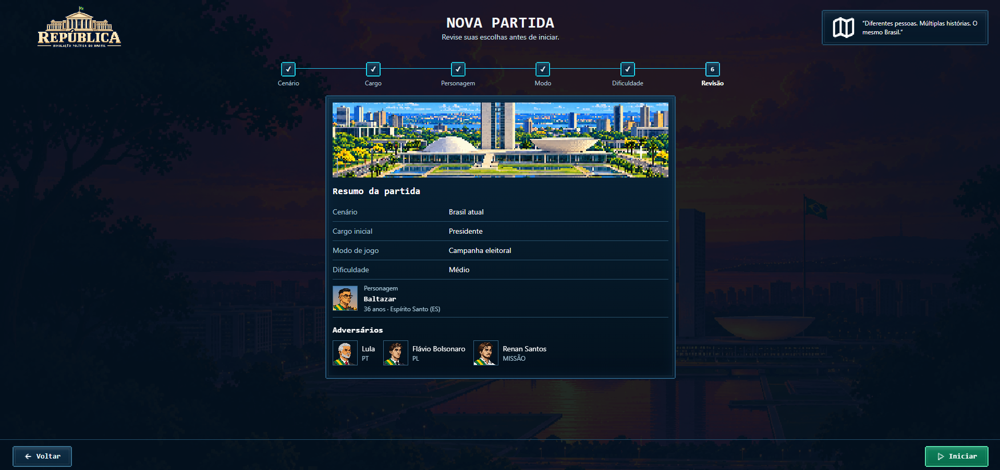
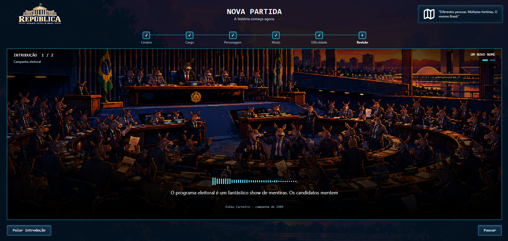
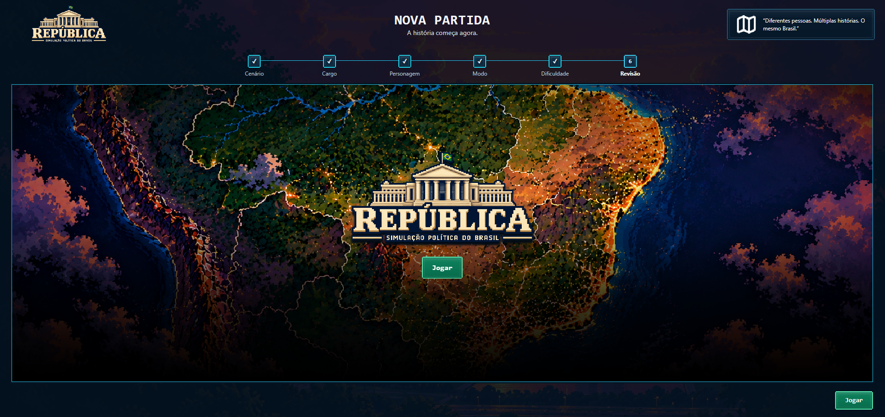
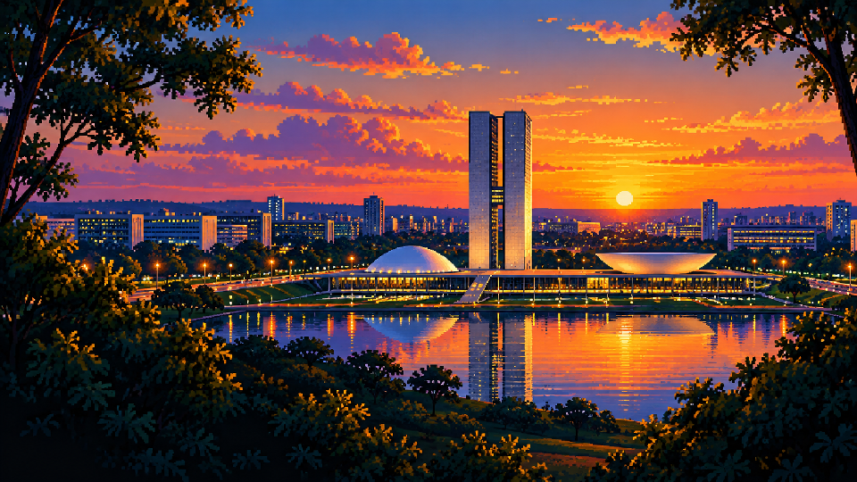
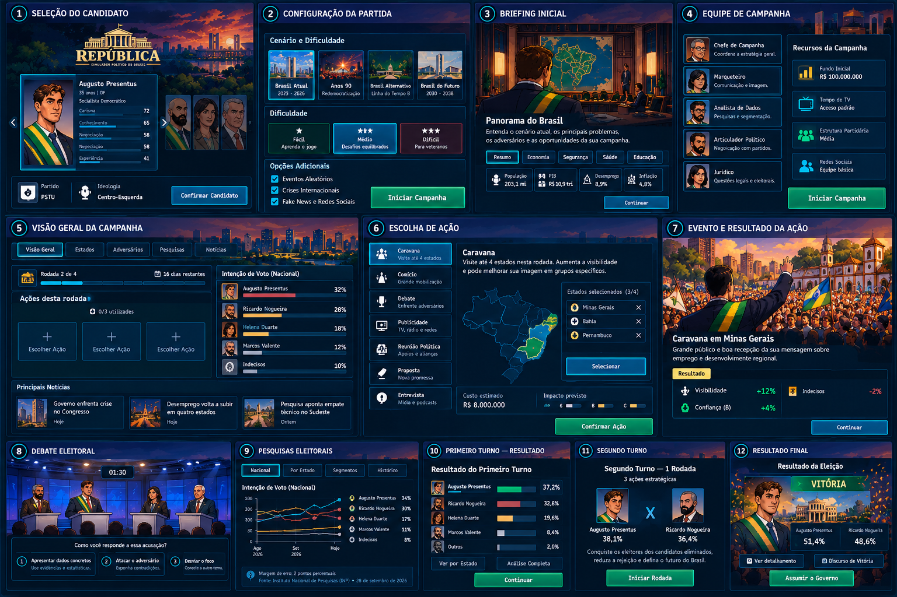
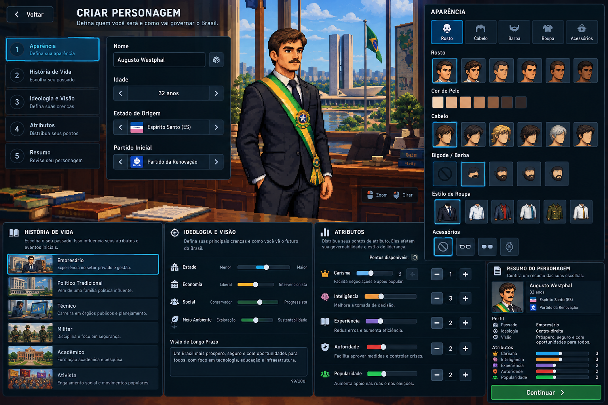

# República

**Um jogo de simulação política, econômica e social sobre as escolhas que moldam um país.**

República convida o jogador a construir uma trajetória política, disputar eleições e, futuramente, governar diante de instituições, interesses regionais e consequências que se acumulam ao longo do tempo. A primeira experiência está sendo desenvolvida para navegadores, com o Brasil contemporâneo como cenário inicial e uma identidade visual em pixel art.

> **Projeto em desenvolvimento.** Este repositório apresenta a visão e o progresso do projeto. As mecânicas descritas como propostas ainda não representam funcionalidades completas ou validadas.

## A experiência

O ponto de partida é um personagem criado pelo jogador, com identidade, trajetória e posicionamentos próprios. Na campanha presidencial planejada, ele enfrenta adversários, escolhe ações e busca apoio de um eleitorado diverso. O país não é apenas um pano de fundo: suas regiões, indicadores e problemas fornecem contexto para decisões e resultados.

A ambição é que uma vitória eleitoral leve ao exercício do mandato na mesma partida. Governo, instituições e políticas públicas são uma etapa posterior do desenvolvimento.

## Galeria

### Tela inicial da aplicação

Captura do protótipo em execução.

### Personagens

Biblioteca e editor de personagens, incluindo o protótipo visual para debates e a configuração de ideologia.

### Nova partida

Escolha do modo e revisão da configuração antes de iniciar.

### Introdução

Cenas de abertura e transição para a partida.

### Identidade visual

Brasília em pixel art, criada para o cenário de fundo da tela inicial.

### Estudos de interface

As imagens abaixo são **referências conceituais** para o desenvolvimento: apresentam ideias visuais e de experiência, não capturas da versão atual do jogo. Detalhes e funcionalidades podem mudar.

Campanha política — conceito de painel

Criação de personagem — conceito de interface

## O que já foi construído

Com base nos registros de implementação atualizados até **30 de outubro de 2026**:

- **Personagens:** biblioteca local para criar e administrar perfis, customização visual e cópia do perfil para a partida.
- **Fundação da partida:** criação de sessão, mapa do Brasil com 27 unidades federativas, seleção e deslocamento, além de salvamento e carregamento local. A apresentação visual ainda precisa de aprovação.
- **Motor de simulação:** processamento determinístico com seed, comandos e eventos, relógio de jogo, agenda e versões de mecanismos e saves.
- **Cenário e país:** conteúdo do cenário Brasil Atual, estado do país e painel de indicadores; a interface aguarda validação visual.
- **Primeiras etapas eleitorais:** ciclo eleitoral no motor e na interface, estrutura de campanha sem viagem, dados e estado do eleitorado, e painel correspondente. A eleição ainda não é jogável de ponta a ponta.
- **Candidaturas:** conteúdo de partidos e políticos, elenco do cenário e intenção inicial no motor. A interface do elenco permanece pendente; o conteúdo requer revisão editorial e jurídica.
- **Arte de personagens para debates:** composição de poses, roupas, expressões, fala e piscar em protótipo. A aprovação visual e poses adicionais seguem pendentes.

Esses marcos registram entregas de desenvolvimento, não uma versão final. Dados e parâmetros de playtest podem mudar conforme a pesquisa, o balanceamento e as revisões.

## Modelos e protótipos de mecânicas

| Área | Modelo em desenvolvimento | Situação |
|---|---|---|
| Personagem | Identidade, trajetória, atributos, aparência, ideologia e vínculo partidário compõem um perfil reutilizável. | Editor e perfil na partida implementados; aprofundamentos dependem das respectivas mecânicas. |
| País e território | Brasil e suas 27 UFs com indicadores e contexto regional; o mapa representa o estado da partida. | Base e painel implementados; validação visual pendente. |
| Eleitorado | Quatro perfis por UF, totalizando 108 segmentos, com proporções estimadas para playtest. | Conteúdo, estado e painel implementados; reação eleitoral ainda planejada. |
| Ciclo eleitoral | Calendário, fases e rodadas de campanha organizam a disputa presidencial. | Base implementada; ações, apuração e desfechos completos ainda dependem de novas entregas. |
| Candidatos | Elenco inicial de 2026 com jogador e três adversários do cenário; intenção inicial por segmento. | Conteúdo e motor implementados; interface e revisão pendentes. |
| Campanha | Ações como caravana, comício, publicidade, entrevista e proposta, com recursos e estimativas de impacto. | Modelo especificado; catálogo e efeitos completos planejados. |
| Debate, fatos e notícias | Evidências, alegações, promessas e eventos informacionais influenciam a recepção do eleitorado. | Modelo especificado; mecânicas de jogo planejadas, arte em protótipo. |
| Pesquisas e votação | Pesquisas são estimativas falíveis; apuração considera votos e possibilidade de segundo turno. | Especificado e ainda planejado para implementação. |
| Governo | Decisões presidenciais, gabinete e relações institucionais continuam a história após a vitória. | Proposta em revisão, prevista para uma fase posterior. |

O desenho eleitoral reúne 23 mecanismos, da origem dos dados e segmentação até mobilização, votação e transição para o governo. O desenho funcional não significa que todos estejam programados ou calibrados.

## Próximos passos

1. Concluir e revisar a interface do elenco e as validações visuais pendentes.
2. Desenvolver a reação do eleitorado, ações de campanha e decisões dos adversários.
3. Integrar debates, notícias, pesquisas, votação e resultados para tornar a eleição jogável de ponta a ponta.
4. Evoluir a transição para o mandato e as mecânicas de governo, após revisão das regras e dependências.

A ordem e o escopo podem mudar durante o desenvolvimento. Outros cenários, plataformas e sistemas fazem parte da visão de longo prazo, sem promessa de lançamento neste estágio.

## Como o projeto é construído

O núcleo da simulação é separado da interface e da renderização: decisões entram como comandos, regras produzem mudanças de estado e eventos, e a apresentação visual responde a esses resultados. A reprodução de uma sequência depende do estado inicial, da seed e dos comandos. O projeto utiliza TypeScript em um monorepositório, React e Vite na aplicação web, PixiJS no mapa e IndexedDB para persistência local.

A inteligência artificial é concebida como apoio narrativo e de interpretação, sujeita às regras do jogo, e não como fonte autoritativa do estado da simulação.

---

Este repositório é uma apresentação pública em preparação. Código, demonstrações, materiais e informações de colaboração poderão ser adicionados conforme forem disponibilizados.

## Licença

O conteúdo deste repositório está sob a [CC BY-NC-ND 4.0](LICENSE).
